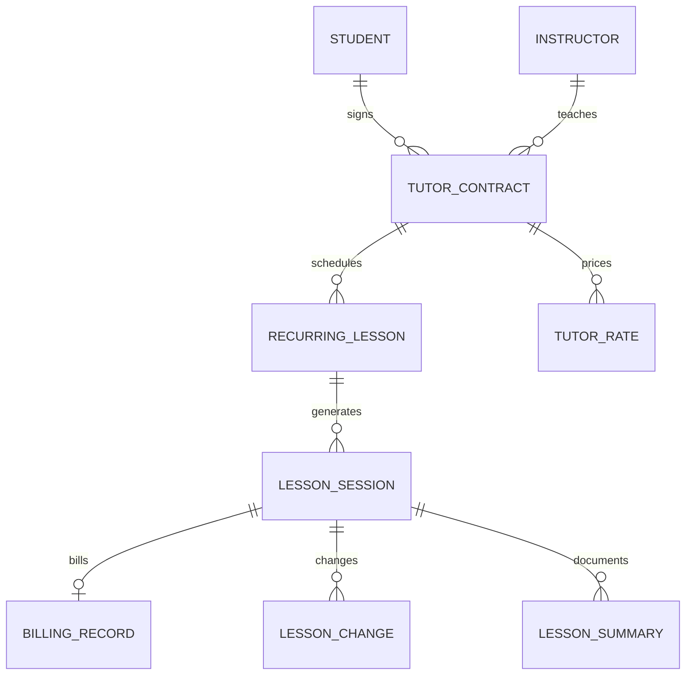

# Tutor Core — Frappe 分支（未完成的原型）

本目录是独立 Frappe App 的初始代码，**尚不是可运行的 SaaS Demo**。当前环境无 Docker、Bench，且终端无法连接 GitHub，因此未能下载依赖、安装 site、迁移 DocType 或验证 UI、权限和数据库。请勿用于真实数据或生产环境。

## 版本与部署方向

Frappe Education 官方兼容矩阵列出 Education `version-16` 与 Frappe `version-16` 兼容。建议选同一大版本的 Framework、ERPNext、Education 稳定版本并锁定具体 tag/commit；尚未完成三者锁定及实测。Education 官方安装流程先安装 ERPNext，再安装 Education。见 https://github.com/frappe/education 和 https://github.com/frappe/frappe_docker 。

安装目标（以下为待验证的 Bench 步骤，不是已验证启动命令）：

```bash
# 在具备 Frappe v16 Bench 的环境中，安装 ERPNext 与 Education 后：
bench get-app /path/to/frappe-tutor
bench --site education.test install-app tutor_core
bench --site education.test migrate
bench start
```

`bench get-app` 的本地目录方式及命名应在目标 Bench 环境实测；未提供可直接启动的容器配置。

## 代码与模型

`pyproject.toml`、`tutor_core/hooks.py` 为应用入口，`tutor_core/tutor_core/doctype/` 包含 12 个初始 DocType 元数据。`tutor_core/domain.py` 实现纯函数的每周日期生成和按分钟计算金额；`tests/` 是对应的独立 Python 测试。DocType 使用 UUID autoname 的兼容性也尚未在 v16 验证。



Education 的 Student、Instructor、Course、Guardian 和 Fee 应评估复用；课程实例、单次变更、合同、费率、结算、进度记录和事务 outbox 需要 Tutor Core 开发。User、Role、权限、版本审计、File、通知、REST、Webhooks 和后台任务可利用 Frappe 能力；会计、Employee 和 CRM 应按实际需要复用 ERPNext/相关开源应用，不能声称已经接通。

## 关键未完成工作

- 尚无生成课次的持久化逻辑、冲突检测、调课审计或防重约束；单次修改不得更改周期规则。
- 尚无完成课程后自动创建账单、费率选择、费率区间重叠校验、事务/并发保障及历史快照不可变约束。计算函数本身不等于账单系统。
- 当前 DocType 仅 System Manager 有权限，教师、学生、监护人和机构级 RBAC 尚未实现或测试。不能上线；不能把客户端过滤当安全边界。需要逐项测试列表、单条读取、REST、附件与写入。
- 没有教师仪表盘、日历、学生详情、学生门户、演示数据或截图。
- Outbox DocType 仅为占位，缺少事务内事件写入、版本递增、投递、重试、死信、幂等和消费端去重；没有与知识图谱的连接。事件契约计划包含 lesson.created/updated/completed/cancelled、student.created/updated、lesson_summary.created/updated，带 event_id、event_type、entity_id、entity_version、occurred_at、tenant_id。业务系统保留事实所有权。
- 无真实负载测试、用户规模验证、部署自动化、备份恢复方案。开源复用比例无法客观量化，当前未实测集成，不能给出有依据的百分比。

## 多租户方向

建议商业化初期采用 site-per-tenant：每机构独立站点与数据库，借助 Frappe 原生多站点减少跨租户数据泄漏风险，但要承担站点生命周期、升级、备份和运维成本。单站点 organization_id 可降低站点数量，却需要在所有 DocType、REST、附件、后台任务、报表和搜索上完整执行行级隔离；本原型并未实现这种隔离。超大客户或合规要求不同的客户可单独部署；容量需压测，100–1000 教师、10000+ 学生不是已验证指标。

## 许可证

此原型计划以 GPL-3.0-or-later 提供；Frappe Framework、ERPNext、Education 各自的仓库许可证及具体版本、组合与分发方式必须逐项核查。GPL 通常要求分发衍生作品时满足相应源代码和许可证义务，普通 GPL 与 AGPL 的网络使用条款不同；SaaS 架构、定制及交付是否触发义务应结合实际由律师判断，此处不是法律意见。

## 测试

```bash
python3 -m unittest discover -s tests -v
```

以上仅测试纯 Python 计算，不能证明 Frappe 集成、权限或安全正确。
